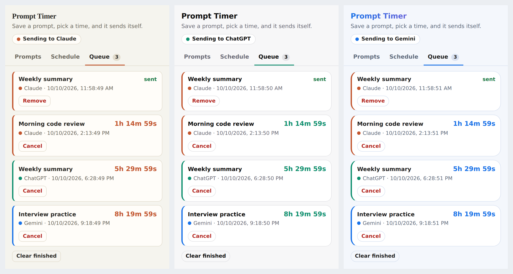
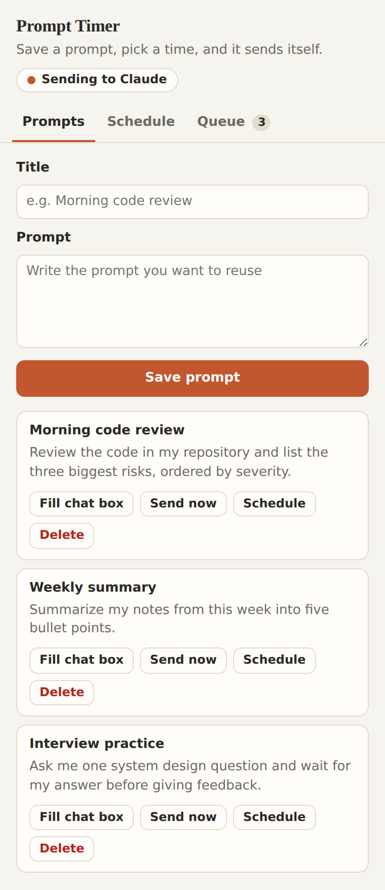
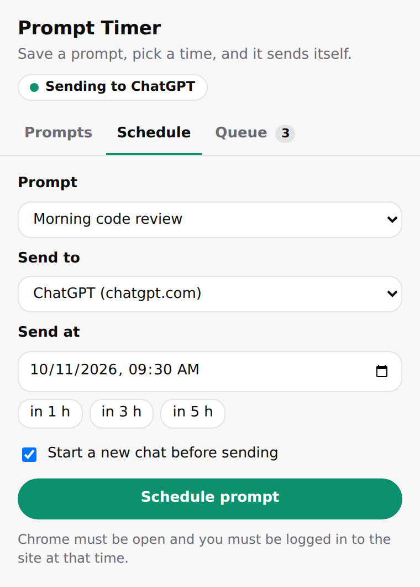
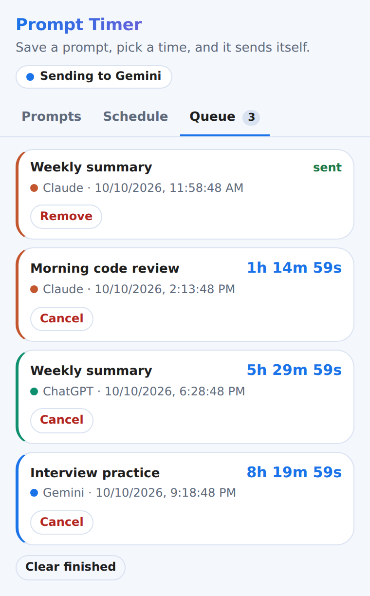

<div align="center">


# Prompt Timer for AI Chats

**Save prompts, pick a time, and let your browser send them to Claude, ChatGPT or Gemini for you.**

[](LICENSE)
[](https://developer.chrome.com/docs/extensions/develop/migrate/what-is-mv3)


[Install](#installation) &middot; [Usage](#usage) &middot; [How it works](#how-it-works) &middot; [Roadmap](#roadmap) &middot; [Contributing](CONTRIBUTING.md)

</div>

<!--
  DEMO GIF: record a ~15 second screen capture (save a prompt, schedule it, watch it send),
  save it as docs/demo.gif and uncomment the next line.
  
-->



## Why this exists

AI chat services limit how much you can use them within a time window. Some, such as Claude,
use a rolling window that starts with your first message. Prompt Timer lets you queue a prompt
for the moment you want it sent, for example right after a window resets, without having to be
at the keyboard. It sends exactly what you would otherwise type yourself. It does not bypass,
raise or alter any usage limit. See each provider's documentation for how its limits work.

## Features

- **Prompt library:** save prompts with titles and reuse them.
- **Scheduled sending:** pick a date and time, or use the quick "in 1 h / 3 h / 5 h" buttons.
- **Three sites:** Claude (`claude.ai`), ChatGPT (`chatgpt.com`) and Gemini (`gemini.google.com`).
- **New chat option:** start a fresh conversation before sending, so the prompt never lands in an old chat.
- **Live queue:** countdown timers, statuses (`pending`, `running`, `sent`, `failed`, `missed`) and readable error notes.
- **Desktop notifications** when a prompt is sent, fails or is missed.
- **Verified sending:** a prompt is reported as sent only after the extension confirms it.
- **Resilient timers:** alarms are restored after a browser restart; jobs more than 30 minutes late are skipped, not sent.
- **Site-aware design:** the popup adopts the look of the site you are sending to, in light and dark mode.
- **Private by design:** everything stays on your device. No servers, accounts or tracking. See [PRIVACY.md](PRIVACY.md).
- **No dependencies, no build step:** plain HTML, CSS and JavaScript.

## Screenshots

<table>
  <tr>
    <td align="center"><br><sub>Prompts</sub></td>
    <td align="center"><br><sub>Schedule</sub></td>
    <td align="center"><br><sub>Queue</sub></td>
  </tr>
</table>

## Installation

> The extension is not on the Chrome Web Store. You load it in developer mode.

### Option A: from a release (easiest)

1. Download the latest `prompt-timer-extension-vX.Y.Z.zip` from the [Releases page](https://github.com/singhvishal130405-boop/prompt-timer/releases).
2. Unzip it somewhere permanent. Chrome loads the extension from that folder, so do not delete it.
3. Open `chrome://extensions` and turn on **Developer mode** (top right).
4. Click **Load unpacked** and select the unzipped folder.
5. Pin the extension from the puzzle-piece menu.

### Option B: from source

```bash
git clone https://github.com/singhvishal130405-boop/prompt-timer.git
```

Then follow steps 3 to 5 above, choosing the `src/` folder in the cloned repository.

Works in Chrome and other Chromium-based browsers that support Manifest V3.

## Usage

1. Open the extension and, in the **Prompts** tab, save a prompt.
2. Use **Fill chat box** or **Send now** on an open AI tab to test that it works.
3. In the **Schedule** tab, choose the prompt, the site and the time. Tick **Start a new chat before sending** if you want a fresh conversation.
4. Watch it count down in the **Queue** tab. When the time comes, the extension switches to the site's tab, types the prompt and sends it.

**Requirements at send time:** Chrome must be running, the computer awake, and you must already be logged in to the chosen site.

## How it works

An extension is three small programs that talk by messages:

```
 Popup (UI)            Service worker               Content script
 popup.js              background.js                content.js
 ----------            -------------                ----------------
 save prompts   --->   alarm fires        --->      finds chat box
 create job            opens / finds tab            types the prompt
 set alarm             asks the page to send        clicks Send
                       marks sent / failed   <---   confirms it worked
```

- **Popup** (`popup.html`, `popup.css`, `popup.js`): the interface. It stores prompts and jobs in `chrome.storage.local` and creates a `chrome.alarms` timer for each job.
- **Service worker** (`background.js`): wakes when an alarm fires, finds or opens the right tab, optionally starts a new chat, and sends a message to the page. It records the result and shows a notification.
- **Content script** (`content.js`): runs inside the three sites. It locates the chat box, types the prompt the way a person would (a simulated paste into the rich-text editor), finds the Send button, sends, and verifies that the message really went out.

Why `chrome.alarms` and not `setTimeout`? The service worker is shut down when idle, which would kill any in-memory timer. Chrome keeps alarms and wakes the worker for you.

More detail is in [docs/ARCHITECTURE.md](docs/ARCHITECTURE.md).

## Project structure

```
prompt-timer/
├── src/                    The extension (load this folder in Chrome)
│   ├── manifest.json       Configuration and permissions (Manifest V3)
│   ├── background.js       Service worker: alarms, tabs, retries, status
│   ├── content.js          Page script: types and sends, per-site selectors
│   ├── popup.html/.css/.js The popup interface and site themes
│   └── icons/
├── docs/                   Architecture notes and the developer guide
├── screenshots/            Images used in this README
├── .github/                Issue templates, pull request template, CI
├── CHANGELOG.md
├── CONTRIBUTING.md
├── PRIVACY.md
├── SECURITY.md
└── LICENSE
```

## Permissions

| Permission | Why it is needed |
|---|---|
| `storage` | Save prompts and scheduled jobs on your device |
| `alarms` | Wake the background worker at the scheduled time |
| `notifications` | Report sent, failed or missed prompts |
| `scripting` | Inject the page script when a tab does not have it yet |
| Host access to `claude.ai`, `chatgpt.com`, `gemini.google.com` | Fill the chat box and press Send on those sites only |

## Privacy

All data stays in your browser's local extension storage. The extension makes no network
requests, collects no analytics and has no remote code. It reads the chat box text only to
confirm a prompt was typed and sent, never your conversation history. Full details:
[PRIVACY.md](PRIVACY.md).

## Troubleshooting

| Problem | What to try |
|---|---|
| Nothing happens at the scheduled time | Chrome must be running and the computer awake. Check the Queue tab for a status or error note. |
| "Couldn't find the chat box" | Make sure you are logged in. The site's page may have changed; see below. |
| Typed but not sent | The Send button selector may have changed; see below. |
| "Receiving end does not exist" | Reload the AI tab, or reload the extension in `chrome://extensions`. |
| Marked **missed** | The browser was closed and the job was more than 30 minutes late. Jobs that late are skipped on purpose. |

**Websites change.** The sites' page structures are outside this project's control. All
site-specific selectors live in one object at the top of [`src/content.js`](src/content.js).
To fix a site: right-click the chat box, choose **Inspect**, pick a stable attribute (`id`,
`data-testid`, `aria-label`), add it at the top of that site's list, reload the extension and
the page. Please also open a ["Selector broke" issue](https://github.com/singhvishal130405-boop/prompt-timer/issues/new/choose)
so others benefit.

## Limitations

- Chrome must be running and you must be logged in at send time.
- One-time schedules only (repeat schedules are planned).
- Selectors can break when a site redesigns its interface.
- The tab is brought to the foreground when the timer fires.

## Challenges and solutions

Real problems met while building and testing across three sites:

1. **Typed but never sent.** The Send button was not always found, and a synthetic Enter key press was ignored, yet success was reported. *Fix:* layered button detection, several send routes, and a real verification step.
2. **"Receiving end does not exist" on Claude.** Chrome only injects content scripts into pages opened after the extension loads. *Fix:* inject the script programmatically when a tab has none.
3. **Silent failure on ChatGPT.** The sent-check held a reference to the chat box, which the site replaced while re-rendering, so a detached element looked like success. *Fix:* look the element up fresh each time and also watch for the URL change.

## Roadmap

- [x] Save prompts and schedule one-time sends
- [x] Claude, ChatGPT and Gemini support
- [x] Verified sending, retries and restore after restart
- [x] Site-aware themes
- [ ] Repeating schedules (daily / every N hours)
- [ ] Edit saved prompts
- [ ] Import and export prompts as JSON
- [ ] Options page (late-send limit, default site)
- [ ] Optional reminder notification before a send

Ideas and bug reports are welcome in the [issue tracker](https://github.com/singhvishal130405-boop/prompt-timer/issues).

## Development note

I designed, wrote, trained and tested this project myself. I used AI for code reviews, debugging, fixing syntax errors and drafting parts of the documentation.

## Contributing

Contributions are welcome. Please read [CONTRIBUTING.md](CONTRIBUTING.md) first. For security
issues, see [SECURITY.md](SECURITY.md).

## License

Released under the [MIT License](LICENSE). &copy; 2026 Vishal Singh.

## Disclaimer

Prompt Timer is an independent personal project. It is **not affiliated with, endorsed by or
sponsored by Anthropic, OpenAI or Google.** Claude, ChatGPT and Gemini are trademarks of their
respective owners. Using this tool is your responsibility: follow each service's terms of use,
use it for your own prompts in your own logged-in session, and do not use it for spam or bulk
automation.

---

<div align="center">
Made by <a href="https://github.com/singhvishal130405-boop">Vishal Singh</a>
</div>
